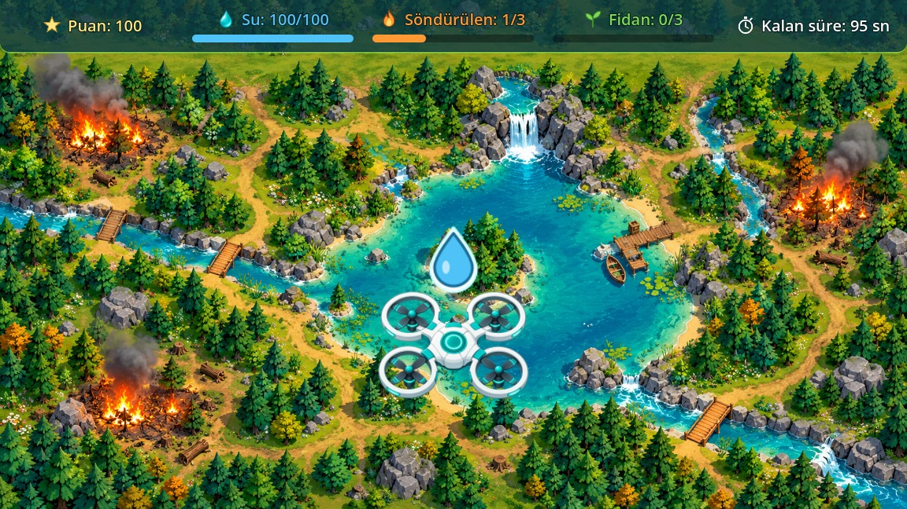
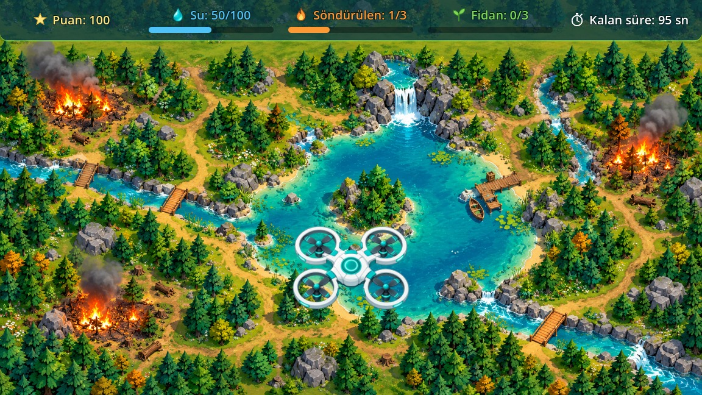
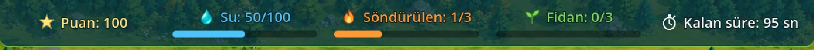

# Yeşil Dron / Green Drone

**Türkçe** | [English](#english)

  

Ormanı korumak için su taşıyan bir dronun yönetildiği, Godot ile geliştirilen 2D oyun prototipi.

*Bu proje, GameUp Türkiye Yapay Zekâyla Oyun Geliştirme İleri Düzey Eğitimi sürecinde bireysel olarak geliştirilmiş bir oyun prototipidir. GameUp Türkiye'nin resmî bir ürünü veya kurum tarafından onaylanmış bir çalışma değildir. Eğitim materyalleri bu depoda paylaşılmamaktadır.*



## Proje hakkında

Oyuncu, dronu orman ve göl haritası üzerinde ok tuşlarıyla yönetir. Dron gölün üzerinde 2 saniye kalırsa su deposu dolar, damla efekti görünür ve dolum sesi çalar.

**Bu proje tamamlanmış bir oyun değil, çalışan bir prototiptir.** Şu an yangın söndürme, görev veya oyun bitişi yoktur (bkz. [Henüz geliştirilmeyenler](#henüz-geliştirilmeyenler)).

## Ekran görüntüleri

| Dolum sırasında | HUD |
|---|---|
|  |  |

Görüntüler Godot'ta çalışan oyundan alınmıştır.

## Mevcut özellikler

- Ana menü: Başla ve Çıkış
- Ok tuşlarıyla dört yönde, ekran sınırları içinde hareket
- HUD göstergeleri: puan, su, söndürülen, fidan, kalan süre
- Ada hariç tutulan göl alanı
- Gölde 2 saniyelik su dolumu; erken çıkışta iptal, dolu depoda engel
- Başarılı dolumda ses ve 0,8 saniyelik damla efekti
- Esc ile menüye dönüş ve yeniden başlama

## Henüz geliştirilmeyenler

| Mekanik | Durum |
|---|---|
| Oyun bitişi, kazanma, kaybetme | Yok |
| Yangın söndürme | Yok; yangınlar haritaya çizili |
| Fidan dikme | Yok |
| Geri sayım | Yok |
| Su harcama | Yok; su normal oynanışta azalmaz |
| Eyleme bağlı puan | Yok |
| Oyun içi Yeniden Başla seçeneği | Yok; Esc, menü ve Başla yolu kullanılır |

HUD'daki söndürülen (1/3), fidan (0/3) ve kalan süre (95 sn) **sabit test değerleridir**.

## Kullanılan teknolojiler

- Godot 4.7.2, GL Compatibility
- GDScript
- Godot sahneleri, `Area2D`, `Timer`, `Tween`, `AudioStreamPlayer`, `CanvasLayer`

## Çalıştırma

1. [Godot 4.7](https://godotengine.org/) sürümünü kurun.
2. Depoyu klonlayın veya indirin.
3. Godot'ta `project.godot` dosyasını açın. İlk açılışta varlıklar içe aktarılır.
4. F5 ile çalıştırın.

| Tuş | İşlev |
|---|---|
| Ok tuşları | Dronu hareket ettirir |
| Esc | Ana menüye döner |
| Fare veya Enter | Menü düğmeleri |

Proje yalnızca Windows'ta test edilmiştir.

## Test sonuçları

Testler iki ayrı gruptadır ve birbirine eklenmez. Bu sonuçlar test edilen kapsamı gösterir; hatasızlık garantisi vermez.

**Otomatik kontroller: 111/111** (bu yayın kopyasında, Windows, Godot 4.7.2, 2 Kasım 2026). Girdiler kodla simüle edilmiştir; ses için duyulma değil, tetiklenme ölçülür.

| Betik | Sonuç |
|---|---|
| `docs/modul10/testler/modul10_testleri.gd` | 48/48 |
| `docs/modul8/testler/dolum_testi.gd` | 37/37 |
| `docs/modul8/testler/ses_testi.gd` | 26/26 |

**Bilinen uyarı:** Bazı `dolum_testi.gd` çalıştırmalarının kapanışında Godot, `1 resources still in use at exit` iletisini yazdı. Bu çalıştırmalarda kontroller geçti ve çıkış kodu 0 oldu. Uyarının nedeni henüz araştırılmadı.

**Manuel test: 6/6** (geliştiricinin beyanı, tarih doğrulanamadı). Asıl projede elle uygulanmıştır; ayrıntı: [manuel_test_sonuclari.md](docs/modul10/manuel_test_sonuclari.md).

Boş depo gibi normal oynanışta oluşmayan durumlar, test betiğinde su değeri atanarak kontrol edilmiştir. Ayrıntı: [test_senaryolari.md](docs/modul10/testler/test_senaryolari.md).

Testleri çalıştırmak için (`dolum_testi.gd` kendi klasörüne ekran görüntüsü yazar):

```bash
godot --path . -s res://docs/modul10/testler/modul10_testleri.gd
```

## Yapay zekâ kullanımı

| Katkı sahibi | Katkı |
|---|---|
| Beyza Uzun | Proje hedefleri, görsel ve ses seçimleri, uygulama onayları, manuel kontroller |
| Claude Code | Kod, sahneler, HUD, HUD ikonları, görsel temizliği, test betikleri, teknik belgeler |
| ChatGPT | Dron, su damlası ve harita görsellerinin üretimi; planlama ve değerlendirmede danışmanlık (kullanıcı beyanı) |

Ayrıntı: [yapay_zeka_katki_beyani.md](docs/modul10/yapay_zeka_katki_beyani.md).

## Varlıklar ve lisans

Varlıkların kaynakları ve doğrulanamayan bilgiler [ASSETS.md](ASSETS.md) dosyasındadır.

Oyun kodları, test kodları, sahneler ve açıkça belirtilen teknik yapılandırma dosyaları [MIT Lisansı](LICENSE) ile lisanslanmıştır; kapsam `LICENSE` dosyasının başında yazılıdır.

**Görseller, sesler, SVG dosyaları, ekran görüntüleri ve belgeler bu lisansın kapsamında değildir.**

## Geliştirici

Beyza Uzun

---

<a id="english"></a>

# Green Drone (English)

[Türkçe](#yeşil-dron--green-drone) | **English**

A 2D game prototype built with Godot, in which you pilot a drone that carries water to protect a forest.

*This is an independent game prototype developed during the 'GameUp Türkiye Yapay Zekâyla Oyun Geliştirme İleri Düzey Eğitimi' training program. It is not an official GameUp Türkiye product or an endorsed project. Course materials are not included in this repository.*

## About

The player flies the drone over a forest and lake map with the arrow keys. If the drone stays over the lake for 2 seconds, the water tank fills, a droplet effect appears and a fill sound plays.

**This is a working prototype, not a finished game.** There is currently no firefighting, objective or game ending (see [Not yet implemented](#not-yet-implemented)).

## Current features

- Main menu: Start (Başla) and Quit (Çıkış)
- Four-way movement with arrow keys, within screen bounds
- HUD: score, water, extinguished fires, saplings, time left
- Lake area that excludes the island
- 2-second water fill: cancelled on early exit, blocked when the tank is full
- Sound and a 0.8-second droplet effect on a successful fill
- Esc returns to the menu; the game can be restarted from there

The game interface is in Turkish.

## Not yet implemented

| Mechanic | Status |
|---|---|
| Game ending, winning, losing | Not implemented |
| Firefighting | Not implemented; fires are drawn on the map |
| Planting saplings | Not implemented |
| Countdown | Not implemented |
| Water consumption | Not implemented; water does not decrease in normal play |
| Score from actions | Not implemented |
| In-game restart option | Not implemented; use Esc, the menu and Start |

The extinguished (1/3), saplings (0/3) and time left (95 s) values in the HUD are **static test values**.

## Technologies

- Godot 4.7.2, GL Compatibility
- GDScript
- Godot scenes, `Area2D`, `Timer`, `Tween`, `AudioStreamPlayer`, `CanvasLayer`

## Running the project

1. Install [Godot 4.7](https://godotengine.org/).
2. Clone or download this repository.
3. Open `project.godot` in Godot. Assets are imported on first open.
4. Press F5.

| Key | Action |
|---|---|
| Arrow keys | Move the drone |
| Esc | Return to the main menu |
| Mouse or Enter | Menu buttons |

The project has only been tested on Windows.

## Test results

The two groups below are separate and are not added together. They show the tested scope and do not guarantee the absence of bugs.

**Automated checks: 111/111** (on this release copy, Windows, Godot 4.7.2, 2 November 2026). Inputs were simulated in code; for sound, triggering is measured, not whether it can be heard.

| Script | Result |
|---|---|
| `docs/modul10/testler/modul10_testleri.gd` | 48/48 |
| `docs/modul8/testler/dolum_testi.gd` | 37/37 |
| `docs/modul8/testler/ses_testi.gd` | 26/26 |

**Known warning:** At exit, some `dolum_testi.gd` runs printed the Godot message `1 resources still in use at exit`. The checks passed and the exit code was 0 in those runs. The cause has not been investigated yet.

**Manual test: 6/6** (developer's statement; date not verified). Performed by hand on the original project. Details are in Turkish: [manuel_test_sonuclari.md](docs/modul10/manuel_test_sonuclari.md).

Situations that do not occur in normal play, such as an empty tank, were checked by setting the water value from the test script.

## Use of AI

| Contributor | Contribution |
|---|---|
| Beyza Uzun | Project goals, visual and audio choices, implementation approvals, manual checks |
| Claude Code | Code, scenes, HUD, HUD icons, image cleanup, test scripts, technical documents |
| ChatGPT | Generation of the drone, water drop and map images; advisory support in planning and evaluation (user statement) |

## Assets and license

Asset sources and unverified information are listed in [ASSETS.md](ASSETS.md) (in Turkish, with an English summary).

Game code, test code, scenes and the listed technical configuration files are licensed under the [MIT License](LICENSE); the scope is stated at the top of the `LICENSE` file.

**Images, audio, SVG files, screenshots and documents are not covered by this license.**

## Developer

Beyza Uzun
